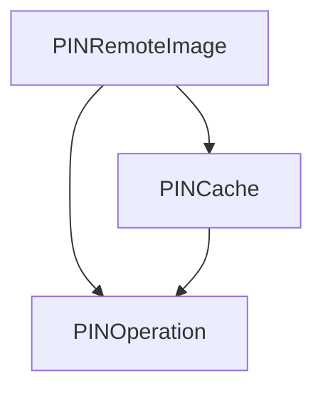

# Dependencies

This a brief attempt to rationalize this project's dependencies and any
relationships between them.  Now that AsyncDisplayKit is removed, it
becomes simpler but not trivial.

## Alamofire - http layer

Might be overkill for what we do here, but I started with it, it is well
maintained, and it has not been a problem.

## PINRemoteImage - async image loading

PINRemoteImage results in smooth async image loading where it matters -
Search Results.  I tried replacing it with Alamofire 4 image loading, and
it was janky, so I backed off.  I haven't tried with Alamofire 5.

Sadly, PINRemoteImage has 2 dependencies and all together they do not seem
to be consistently maintained.  The relationships are:

This dependency chain is a giant pain to deal with when new Xcode releases
come out that increase the minimum IPHONEOS_DEPLOYMENT_TARGET.  See these PRs
for guidance in case this situation arises again:
* https://github.com/pinterest/PINOperation/pull/56
* https://github.com/pinterest/PINCache/pull/327
* https://github.com/pinterest/PINRemoteImage/pull/641

## Valet - keychain storage

Valet made it so simple to store accounts and authtokens in the iOS keychain.

## Toast-Swift - toasts

Timed popup messages are not so big a deal, but this is a tiny package.

## zxingify-objc - barcode generation

Used to display the barcode on the Show Card screen.
